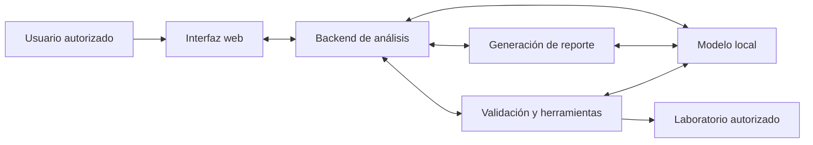
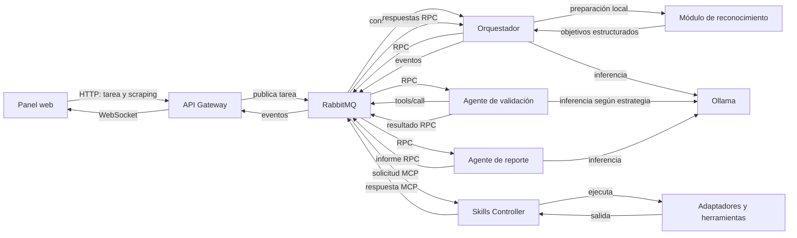
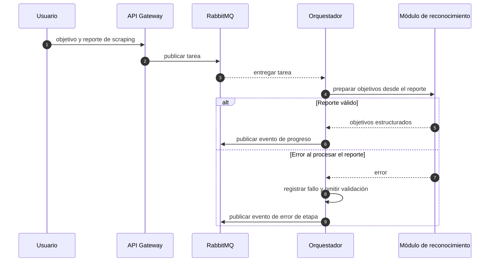
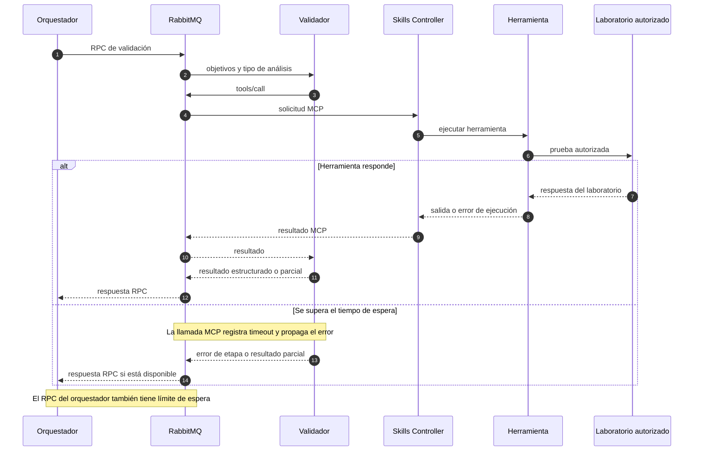
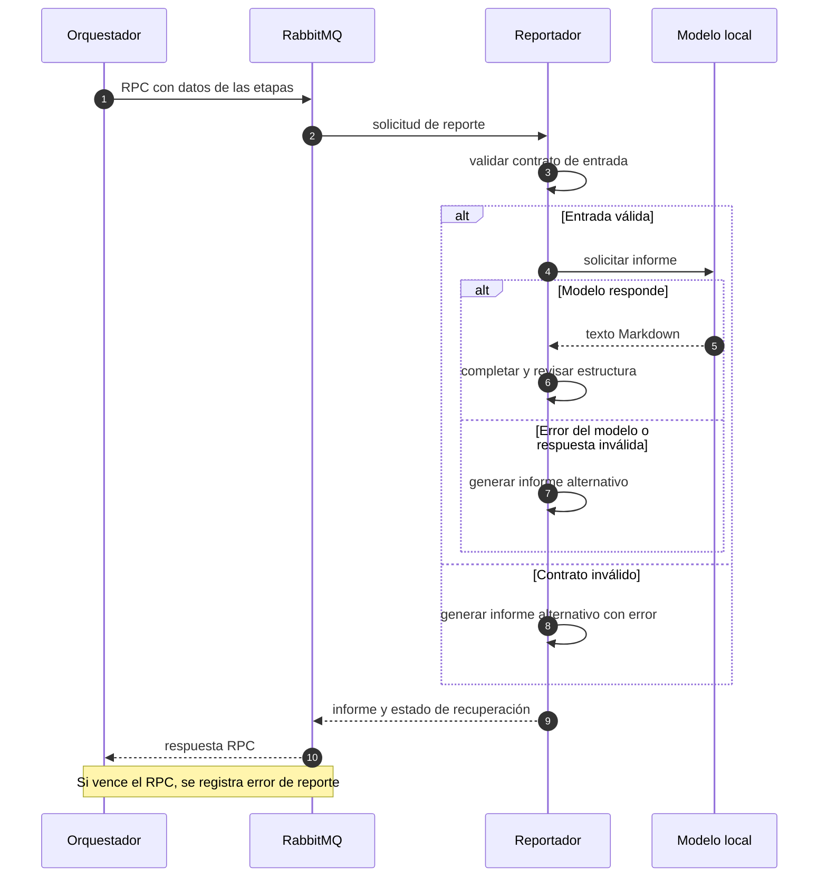
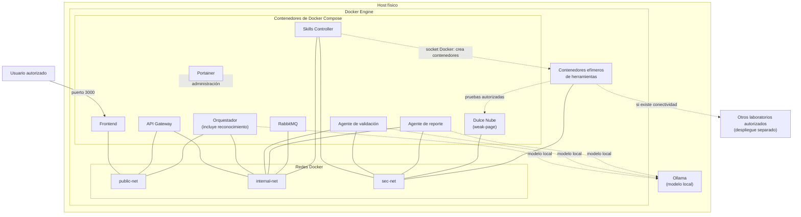

# Informe Final — Proyecto SECURE

## Resumen / Abstract

El proyecto SECURE propone el diseño e implementación de un sistema multiagente inteligente basado en el Model Context Protocol (MCP) para automatizar la detección y validación de vulnerabilidades web en entornos de laboratorio autorizados. Para superar las limitaciones de las herramientas de pentesting tradicionales —que generan grandes volúmenes de datos y requieren un esfuerzo manual considerable—, SECURE estructura el flujo mediante un orquestador, un módulo local de reconocimiento y agentes de validación y reporte. RabbitMQ transporta tareas, eventos y solicitudes entre componentes; las herramientas se ejecutan en contenedores Docker efímeros.

El sistema incorpora capacidades orientadas a cuatro categorías del OWASP Top 10 (A05 Inyección, A01 Control de Acceso Roto, A07 Fallos de Autenticación y A04 Fallos Criptográficos). Se reportaron ejecuciones de integración en Juice Shop y WackoPicko, y pruebas en el laboratorio propio Dulce Nube, que dispone de niveles configurables de vulnerabilidad. Las pruebas por componentes y las ejecuciones reportadas muestran avances en el funcionamiento del pipeline, sin demostrar una tasa general de falsos positivos ni la validación exhaustiva de todos los vectores. El sistema se posiciona como una herramienta formativa que asiste al evaluador humano sin reemplazarlo.

## 1. Introducción

En el panorama actual del desarrollo de software, la evaluación periódica de la seguridad en aplicaciones web es un componente crítico. Los equipos de desarrollo y ciberseguridad utilizan diversas herramientas de análisis para identificar debilidades. Sin embargo, los flujos de análisis suelen generar grandes cantidades de información técnica heterogénea que requiere una interpretación manual considerable, especialmente cuando los resultados de diferentes herramientas deben correlacionarse.

Esta dificultad afecta especialmente a estudiantes y desarrolladores que aprenden a evaluar aplicaciones y necesitan comprender qué se probó y por qué. SECURE propone organizar el flujo mediante etapas especializadas, herramientas MCP y un panel gráfico que muestre resultados y eventos. La oportunidad identificada es facilitar la revisión de evidencias sin reemplazar la evaluación humana ni autorizar pruebas fuera de los laboratorios definidos.

## 2. Marco conceptual

Para comprender la propuesta de SECURE es necesario establecer los conceptos que enmarcan sus decisiones de diseño:

- **Evaluación de seguridad y OWASP:** una categoría agrupa riesgos; un vector es una forma concreta de manifestarlos; una *skill* es una capacidad o herramienta utilizada para examinarlos [9, 19]. La severidad cualitativa se relaciona conceptualmente con CVSS v3.1, sin que ello implique que cada hallazgo tenga un cálculo CVSS completo [6].
- **LLM y etapas especializadas:** un modelo de lenguaje genera texto a partir de contexto y puede utilizar herramientas; sus respuestas requieren comprobación [2, 17, 18]. La división de tareas entre agentes es un enfoque habitual en inteligencia artificial [12]. SECURE divide responsabilidades entre orquestación, preparación de objetivos, validación y reporte; la preparación de objetivos actual es determinística.
- **MCP:** protocolo que permite describir y solicitar herramientas mediante mensajes estructurados [1]. El controlador ofrece un catálogo y media su ejecución; el registro de una herramienta no demuestra por sí solo su integración completa ni su precisión.
- **Contenedores efímeros:** las herramientas pueden ejecutarse en contenedores temporales con límites de recursos [5]. Esto reduce interferencias, pero no garantiza por sí solo la seguridad del host ni la reproducibilidad si las imágenes cambian o se usa el socket Docker.
- **Mensajería y contratos:** RabbitMQ y el patrón RPC usan colas, `reply_to` y `correlation_id` para comunicar etapas [11]. Pydantic permite validar estructuras de datos [10]; ninguna de estas tecnologías garantiza por sí sola entrega sin pérdida o corrección semántica.
- **SPA y evidencia:** una aplicación de página única puede generar rutas y solicitudes mediante JavaScript. Playwright permite automatizar un navegador para observar dichas interacciones [7]. La evidencia de SECURE comprende, según la herramienta y los datos disponibles, solicitudes, salidas, identificadores, tiempos y hallazgos.

En una evaluación, la selección de una categoría no equivale a comprobar todos sus vectores. Por ejemplo, una prueba de SQLi examina un posible tratamiento inseguro de entradas en consultas; una prueba de XSS busca evidencias relacionadas con la ejecución de contenido en el navegador; y una prueba de IDOR examina si una identidad puede acceder a recursos que no le corresponden. En autenticación, el análisis de JWT puede considerar características del token y la respuesta del servicio, mientras que en criptografía interesan, entre otros aspectos, los algoritmos y su uso en el contexto de la aplicación.

La evidencia debe interpretarse junto con el resultado de la ejecución: un hallazgo confirmado requiere sustento observable; un resultado sin confirmación no demuestra por sí solo que el sistema sea seguro. Un timeout, un fallo de comunicación o la ausencia de datos suficientes limitan la conclusión. Las categorías de severidad son una ayuda para priorizar la revisión y no sustituyen el análisis del impacto en cada entorno.

La separación entre preparación, validación y reporte también define cómo se relacionan los conceptos anteriores. La preparación identifica solicitudes relevantes para el tipo de análisis; la validación utiliza herramientas para obtener evidencia; y el reporte organiza los resultados para su revisión. MCP ofrece un punto común para describir e invocar herramientas, mientras RabbitMQ transporta solicitudes y respuestas entre los servicios que lo utilizan.

La relación prevista entre categorías, vectores y capacidades se presenta a continuación. Es una delimitación funcional, **no una afirmación de cobertura exhaustiva ni de que todos los vectores hayan sido validados de extremo a extremo**.

| Categoría de referencia | Ejemplos de vectores | Capacidades relacionadas |
|---|---|---|
| A05:2025 Inyección | SQLi, XSS, inyección de comandos | `sqli_map` / SQLMap, `browserXssValidator`, DalFox, Commix |
| A01:2025 Control de acceso roto | IDOR y exposición de rutas | `access_control_prober`, FFuF y Nuclei |
| A07:2025 Fallos de autenticación | Configuración y validación de JWT | `jwt_tool` |
| A04:2025 Fallos criptográficos | Uso de algoritmos o configuraciones débiles | `crypto_inspector`, `testssl` y Nuclei, según el escenario |

El informe de scraping aporta solicitudes observadas para la preparación de objetivos; las herramientas de descubrimiento y validación tienen funciones distintas y su disponibilidad depende de la configuración del catálogo.
SQLMap y `jwt_tool` documentan sus capacidades y parámetros en sus respectivos proyectos [14, 16].

## 3. Planteamiento del problema

### 3.1 Descripción del problema
En los flujos de auditoría de seguridad, la experiencia operativa presenta dificultades de organización e interpretación:
1. **Complejidad de interpretación:** las salidas extensas y los formatos diferentes dificultan separar resultados relevantes de ruido.
2. **Limitada visibilidad:** sin una trazabilidad común, reconstruir acciones, argumentos y orden de ejecución exige consultar fuentes distintas.
3. **Alertas no correlacionadas:** relacionar un hallazgo con el endpoint y la solicitud que lo originaron requiere trabajo adicional.

Estas dificultades afectan a estudiantes, desarrolladores y evaluadores que deben revisar los resultados; pueden aumentar el tiempo de análisis y favorecer omisiones o interpretaciones erróneas. El problema se delimita a organizar y asistir la revisión de pruebas autorizadas, no a demostrar que toda aplicación evaluada es segura.

### 3.2 Restricciones y supuestos de diseño
- **Entorno de aplicación:** El proyecto restringe su uso a entornos de laboratorio o prueba autorizados (Juice Shop, WackoPicko, Dulce Nube); esta restricción no implica que la plataforma impida técnicamente cualquier otro destino.
- **Marco ético:** Queda excluido el desarrollo de código malicioso, la evasión de defensas no autorizada y las pruebas en producción.
- **Alcance de automatización:** La plataforma asiste y organiza el análisis. No plantea explotación autónoma ni pruebas ofensivas no supervisadas.
- **Desempeño del modelo:** Los resultados del LLM se consideran apoyo y no sustituyen la validación humana.
- **Recursos y dependencias:** la ejecución local requiere Docker, Ollama, el modelo configurado, almacenamiento para imágenes y capacidad de cómputo suficiente; el rendimiento depende del host y del objetivo.
- **Entrada:** se supone que el usuario dispone de un reporte de scraping compatible y de autorización para el objetivo. Para ciertos escenarios, como JWT, también debe proporcionar un token adecuado.
- **Restricciones de evaluación:** los resultados registrados corresponden a un conjunto limitado de escenarios y no constituyen una certificación de seguridad ni una evaluación formal de usabilidad.

### 3.3 Alcance
El proyecto entregó un prototipo funcional que incluye:
1. Etapas de orquestación, preparación de objetivos, validación y reporte.
2. Un catálogo MCP con herramientas de análisis, sujeto a las imágenes y configuración disponibles.
3. Análisis acotado de vectores de las cuatro categorías OWASP mencionadas.
4. Registro estructurado de trazabilidad.
5. Generación de informes Markdown con evidencia y severidad.
6. Pruebas en laboratorios autorizados, incluido Dulce Nube con escenarios configurables.

**Exclusiones:** pruebas no autorizadas o en producción, evasión de defensas, explotación autónoma no supervisada, cobertura exhaustiva de OWASP y certificación de ausencia de vulnerabilidades.

## 4. Objetivos

### 4.1 Objetivo general
Diseñar e implementar un prototipo funcional de sistema multiagente basado en MCP que asista la detección y validación de vulnerabilidades web en entornos de laboratorio autorizados, generando informes estructurados con trazabilidad completa del proceso de análisis.

### 4.2 Objetivos específicos
1. **Diseñar** una arquitectura con orquestación, reconocimiento, validación y reporte, utilizando mensajería asíncrona entre los componentes que la requieren.
2. **Integrar** nueve skills de ciberseguridad mediante MCP en contenedores Docker efímeros.
3. **Cubrir** cuatro categorías del OWASP Top 10: inyección, acceso roto, autenticación y criptografía.
4. **Registrar** evidencia estructurada de cada prueba: endpoint, herramienta, argumentos, salida y confianza.
5. **Generar** un informe técnico con severidad, evidencia, comando reproducible y recomendaciones.
6. **Validar** el flujo completo de extremo a extremo sobre entornos autorizados.
7. **Exponer** la trazabilidad mediante un panel visual interactivo en el frontend.

## 5. Estado del arte / soluciones relacionadas

Las propuestas existentes tienen objetivos y niveles de autonomía diferentes. La siguiente comparación es cualitativa y se basa en las fuentes disponibles; no es una comparación experimental ni demuestra que una funcionalidad esté ausente de un producto.

| Solución | Enfoque y ventaja | Límite para la comparación con SECURE |
|---|---|---|
| CSI [3] | Servicios comerciales de evaluación y gestión de riesgos. | No se dispone aquí de evidencia suficiente sobre su implementación interna. |
| Strix [15] y Shannon [13] | Herramientas de código abierto orientadas a automatizar evaluaciones de seguridad. | Sus objetivos y condiciones de ejecución difieren del prototipo formativo; no se compararon experimentalmente. |
| PentestGPT [4] | Asistencia mediante LLM al proceso de pruebas de penetración. | La publicación no constituye una evaluación directa de la experiencia visual de SECURE. |
| SECURE | Panel web, etapas especializadas, evidencia estructurada y herramientas en contenedores. | Cobertura y usabilidad sujetas a las pruebas limitadas de este proyecto. |

La oportunidad propuesta es combinar apoyo formativo, visibilidad del proceso y revisión humana; no se afirma que estas capacidades sean exclusivas de SECURE.

En las soluciones comerciales, el servicio ofrecido puede facilitar la evaluación a organizaciones que prefieren delegar parte del trabajo, pero la información pública disponible no permite reconstruir todas las decisiones internas ni compararlas directamente con este prototipo. Las propuestas de código abierto, por su parte, permiten examinar su implementación y explorar otros enfoques de automatización, aunque cada una tiene objetivos y condiciones de ejecución propios. PentestGPT estudia el apoyo de un LLM al proceso de pruebas, lo que resulta relevante para contrastar el papel del modelo frente a la intervención del evaluador [4].

SECURE toma como problema específico la lectura y organización de resultados en un contexto formativo. Por ello, su propuesta pone atención en el vínculo entre la solicitud analizada, la herramienta utilizada y la evidencia mostrada, además de incorporar una interfaz para consultar el progreso. La comparación no establece que las demás soluciones carezcan de estas características: para concluirlo sería necesario examinar versiones concretas de cada producto con los mismos criterios.

## 6. Solución propuesta

### 6.1 Descripción general

SECURE es una plataforma web de evaluación asistida que organiza el análisis de seguridad de aplicaciones en entornos autorizados. Integra una interfaz para el usuario, una etapa de orquestación, capacidades de reconocimiento y validación, un catálogo de herramientas mediante MCP y un mecanismo de generación de informes. El propósito es presentar el análisis como un proceso comprensible y revisable, en lugar de limitarse a mostrar las salidas independientes de cada herramienta.

La plataforma recibe un objetivo autorizado y un reporte de scraping con información observada de la aplicación. A partir de estos datos prepara los objetivos de validación, ejecuta las capacidades disponibles para el tipo de análisis seleccionado y presenta eventos y resultados. El informe final reúne los hallazgos y la evidencia disponibles para que una persona pueda revisarlos.

### 6.2 Usuarios objetivo

- **Estudiantes de ciberseguridad o desarrollo:** pueden utilizar la plataforma en laboratorios para comprender las etapas de una evaluación y relacionar una prueba con sus resultados.
- **Desarrolladores de software:** pueden revisar debilidades de aplicaciones propias en entornos de prueba y utilizar la evidencia disponible como apoyo para identificar correcciones.
- **Docentes o evaluadores:** pueden consultar los eventos y el informe para acompañar una práctica, revisar sus resultados y discutir sus limitaciones.

En todos los casos, el usuario es responsable de contar con autorización para el objetivo y de interpretar los resultados. SECURE no sustituye la revisión de un evaluador humano.

### 6.3 Funcionamiento general

El uso de la plataforma se organiza en cinco momentos:

1. **Configuración:** el usuario proporciona la URL del objetivo autorizado, selecciona el tipo de análisis y aporta un reporte de scraping compatible. Algunos escenarios requieren información adicional, como un token para el análisis de JWT.
2. **Preparación de objetivos:** el sistema examina las solicitudes contenidas en el reporte y selecciona las que resultan pertinentes para el análisis solicitado. Esta preparación se realiza actualmente dentro del orquestador.
3. **Validación:** la etapa de validación utiliza las herramientas configuradas para examinar los objetivos y organizar las salidas. Según el caso, puede producir hallazgos, resultados no confirmados o información sobre errores.
4. **Reporte:** los resultados de preparación y validación se consolidan en un informe Markdown que puede incluir severidad, evidencia, comandos y recomendaciones cuando estén disponibles.
5. **Visualización y revisión:** el usuario consulta los eventos del análisis y el informe en el panel. A partir de esa información decide qué resultados requieren comprobación o investigación adicional.

### 6.4 Propuesta de valor

La solución responde a las dificultades identificadas en el planteamiento del problema mediante tres aportes:

- **Organización de resultados:** reúne información de distintas herramientas en una salida estructurada, con el fin de facilitar la lectura de hallazgos y la identificación de su contexto.
- **Visibilidad y trazabilidad:** presenta eventos y datos asociados a la tarea para ayudar a reconstruir las etapas ejecutadas y, cuando la evidencia lo permite, relacionar la solicitud, la prueba y el hallazgo.
- **Integración modular:** utiliza un catálogo MCP como punto de acceso a herramientas especializadas y separa sus responsabilidades de la presentación y la generación del informe. La incorporación de una nueva capacidad puede requerir ajustes de configuración o de las estrategias de validación.

Frente a las soluciones relacionadas descritas en la Sección 5, SECURE prioriza el uso formativo, la presentación visual y la revisión humana. Esta combinación define el enfoque del proyecto, sin afirmar que sea exclusiva ni que se haya demostrado experimentalmente una mejora de usabilidad.

### 6.5 Relación con el alcance y las restricciones

Las capacidades contempladas se relacionan con vectores de inyección, control de acceso, autenticación y criptografía, según se detalla en la Sección 2. Su disponibilidad y el resultado de cada análisis dependen de la configuración, las herramientas y los datos de entrada; no se pretende cubrir exhaustivamente todas las vulnerabilidades de esas categorías.

La propuesta se limita a laboratorios o entornos de prueba autorizados y no incluye pruebas en producción ni explotación autónoma no supervisada. La información del modelo y de las herramientas es apoyo para el evaluador: un resultado inconcluso o un error no debe interpretarse como evidencia de que el objetivo es seguro.

## 7. Metodología de desarrollo

Se adoptó un enfoque de **prototipado iterativo e incremental** con sprints semanales, reuniones de tutoría y sesiones de sincronización. Se eligió porque permitía integrar gradualmente servicios y herramientas, observar sus restricciones y ajustar el diseño sin esperar a completar todo el sistema. El equipo dividió roles entre infraestructura e interfaz, agentes y skills. Las fases fueron:
1. Análisis, requerimientos y diseño arquitectural MCP.
2. Implementación de infraestructura, agentes base y biblioteca de skills.
3. Integración de interfaz gráfica y reportes estructurados.
4. Validación en laboratorio, pruebas y ajustes finales (incluyendo la migración a modelo local Ollama y la creación del laboratorio con niveles de vulnerabilidad).

En cada fase se construyeron o ajustaron componentes y se revisaron salidas y registros antes de avanzar. Entre los artefactos se encuentran la configuración Compose, los contratos, el catálogo de herramientas, el panel, las suites unitarias y los informes Markdown. Las pruebas por componente y las ejecuciones en laboratorio descritas en la Sección 13 sirven para observar el funcionamiento; no sustituyen las evaluaciones pendientes de usabilidad y robustez bajo fallos.

El trabajo de diseño permitió definir la división de responsabilidades, los datos intercambiados y los escenarios autorizados. Durante la implementación, la infraestructura de mensajería y las capacidades de ejecución se integraron con la lógica de validación y de reporte. Posteriormente, el panel permitió exponer el progreso y los resultados al usuario; las observaciones realizadas durante la integración sirvieron para ajustar componentes y contratos.

La evolución del prototipo también incluyó el cambio de proveedor de modelo y la incorporación de un laboratorio propio. Estos ajustes responden a necesidades distintas: operar con un modelo local y disponer de escenarios configurables para el desarrollo. El diseño inicial de un agente de reconocimiento independiente evolucionó hacia una preparación de objetivos dentro del orquestador, usando un reporte de scraping proporcionado como entrada. La Sección 11 documenta esta diferencia entre el diseño anterior y la implementación actual.

## 8. Requerimientos

### 8.1 Funcionales
| ID | Requerimiento |
|----|---------------|
| RF-01 | Recibir URL objetivo y encolar tarea. |
| RF-02 | Realizar reconocimiento automatizado mediante SPA Crawler y Katana. |
| RF-03 | Capturar peticiones HTTP completas en archivos `.req`. |
| RF-04 | Validar SQL Injection mediante SQLMap. |
| RF-05 | Validar XSS mediante DalFox. |
| RF-06 | Validar Command Injection mediante Commix. |
| RF-07 | Ejecutar validación multivectorial mediante Nuclei. |
| RF-08 | Realizar fuzzing de rutas y parámetros mediante FFuF. |
| RF-09 | Generar informe Markdown con evidencia. |
| RF-10 | Exponer trazabilidad estructurada. |
| RF-11 | Ofrecer un panel visual interactivo. |
| RF-12 | Registrar evidencia verificable. |

Se conserva la numeración original. En la implementación actual, la preparación de objetivos consume un reporte de scraping ya proporcionado; no se demuestra con ello que RF-02 o RF-03 se ejecuten automáticamente en cada flujo. El registro en el catálogo o la existencia de un módulo no equivale a demostrar que todos sus flujos funcionen de extremo a extremo.

### 8.2 No funcionales
- **Seguridad:** limitar la operación a entornos autorizados y controlar acceso al host, puertos y socket Docker.
- **Trazabilidad:** asociar eventos y resultados disponibles con el identificador de tarea.
- **Extensibilidad:** describir herramientas en un catálogo; una nueva integración puede requerir cambios en sus estrategias o configuración.
- **Tolerancia a fallos:** comunicar errores y resultados parciales; la durabilidad de una cola no demuestra recuperación integral.
- **Reproducibilidad:** conservar configuración, entradas e imágenes empleadas; las etiquetas `latest` no fijan una versión inmutable.
- **Usabilidad:** presentar el progreso y el informe en una interfaz comprensible; su evaluación formal está pendiente.
- **Mantenibilidad:** utilizar contratos y componentes separados para acotar cambios.
- **Rendimiento:** registrar duración de etapas y herramientas; no se ha establecido un umbral general de aceptación.

## 9. Evaluación de alternativas

Se compararon opciones según acoplamiento, operación, capacidad de sustitución y manejo esperado de tareas prolongadas. La tabla distingue razones de diseño de resultados medidos: no se dispone de una comparación experimental homogénea entre todas las alternativas.

| Decisión | Alternativas | Razón de selección y límite |
|---|---|---|
| Comunicación | RabbitMQ frente a HTTP/gRPC directos | Las colas y RPC desacoplan la publicación del procesamiento [11]; la recuperación de tareas y respuestas depende de la configuración y requiere validación experimental. |
| Modelo | Proveedor remoto frente a Qwen local mediante Ollama | La opción local evita las cuotas HTTP 429 del proveedor remoto, pero depende de recursos y disponibilidad del host [8]. No se presenta aquí una comparación controlada de latencia. |
| Herramientas | Catálogo MCP frente a imports o scripts directos | MCP ofrece una interfaz de descubrimiento y ejecución [1]; nuevas capacidades pueden requerir cambios en estrategias y despliegue. |
| Organización | Etapas y servicios frente a un proceso monolítico | Separar responsabilidades facilita cambios y observación; introduce dependencias de mensajería y no prueba por sí solo mayor disponibilidad. |

La evaluación cuantitativa bajo fallos de LLM, herramientas, broker y reintentos está pendiente; por tanto, estas razones justifican el diseño, no una superioridad medida en resiliencia.

En comunicación, HTTP y gRPC ofrecen alternativas para llamadas directas entre servicios; RabbitMQ introduce un intermediario y permite organizar el intercambio mediante colas y respuestas correlacionadas. Esta elección favorece la separación entre emisor y consumidor, pero también añade una dependencia que debe configurarse y supervisarse.

Para el modelo, un proveedor remoto reduce la necesidad de ejecutar inferencia en el equipo local, aunque depende de conectividad, condiciones de servicio y cuotas. Ollama permite servir el modelo en el host del proyecto, a cambio de consumir recursos locales. La elección se orienta a facilitar la operación del prototipo en su entorno previsto, sin suponer que un modelo local tenga siempre menor latencia o mayor disponibilidad.

En la integración de herramientas, los imports y scripts directos pueden ser sencillos para un número reducido de capacidades, pero vinculan más estrechamente la lógica que las utiliza con su ejecución. MCP proporciona un contrato común de descubrimiento e invocación. Esta interfaz no elimina la necesidad de mantener los adaptadores, las estrategias de validación y las imágenes que cada herramienta requiera.

## 10. Diseño y arquitectura

### 10.1 Arquitectura

#### 10.1.1 Descripción general

SECURE utiliza una **arquitectura orientada a eventos** para comunicar el progreso del análisis, junto con mensajería asíncrona para distribuir tareas y coordinar componentes. RabbitMQ transporta tanto eventos como solicitudes y respuestas RPC; no todos los mensajes del sistema son eventos. La interfaz se comunica con la API mediante HTTP y WebSocket.

El usuario entrega un objetivo autorizado y un reporte de scraping; el backend coordina preparación de objetivos, validación y reporte. La separación lógica responde a la alternativa de etapas comunicadas mediante RabbitMQ presentada en la Sección 9. El modelo local y el laboratorio son dependencias externas a la lógica principal. La Figura 1 muestra estas relaciones sin representar infraestructura.

#### 10.1.2 Componentes del sistema e interacción

##### 10.1.2.1 Descripción de componentes

| Componente lógico | Responsabilidad | Requerimientos relacionados |
|---|---|---|
| Interfaz web | Recibir datos y mostrar eventos e informe. | RF-01, RF-10, RF-11 |
| Backend de análisis | Aceptar tareas, preparar objetivos y coordinar las etapas. | RF-01, RF-02, RF-03, RF-10 |
| Validación y herramientas | Ejecutar las capacidades configuradas y estructurar resultados. | RF-04 a RF-08, RF-12 |
| Reporte | Elaborar el informe con la información disponible. | RF-09, RF-12 |
| Modelo y laboratorio | Proporcionar inferencia y objetivo autorizado para las pruebas. | RF-04 a RF-09 |

**Figura 1. Arquitectura lógica general de SECURE.**

La figura distingue las aplicaciones y servicios lógicos; sus módulos y el despliegue se detallan en las Figuras 2 y 6.

##### 10.1.2.2 Interacción entre módulos

La API publica solicitudes en RabbitMQ y transmite eventos por WebSocket. El orquestador prepara los objetivos mediante un módulo local de reconocimiento que procesa el reporte de scraping recibido y solicita validación y reporte por RPC a través de RabbitMQ. El validador solicita herramientas al controlador de skills a través del broker; los contratos estructurados permiten intercambiar resultados sin depender de imports directos entre servicios. El acoplamiento se reduce a nombres de colas, esquemas y servicios compartidos, pero RabbitMQ y el modelo siguen siendo dependencias operativas.

**Figura 2. Interacción entre módulos de SECURE.**

La Figura 2 muestra dependencias lógicas, no distribución física. El reconocimiento actual prepara objetivos a partir del reporte recibido: no es un servicio RPC independiente ni ejecuta necesariamente crawlers durante cada tarea.

##### 10.1.2.3 Comportamiento

Las Figuras 3 a 5 representan tres procesos del flujo actual. La preparación es local, mientras que validación y reporte esperan respuestas RPC. El orquestador solicita al modelo ejecutar estas etapas en orden mediante instrucciones; el orden no está garantizado por una máquina de estados independiente. La duración puede estar dominada por el modelo, la cola o la herramienta; no se ha hecho una evaluación comparativa de cuellos de botella. La separación facilita sustituir servicios, pero añade serialización y esperas. Los casos de error dibujados describen el tratamiento previsto en el código, no pruebas de resiliencia realizadas.

**Figura 3. Preparación de objetivos desde el reporte de scraping.**

El resultado es un conjunto de objetivos para la etapa siguiente o un fallo explícito de preparación. La entrada es el reporte suministrado, no una captura automática garantizada durante el flujo.

**Figura 4. Validación mediante herramienta MCP.**

El validador puede producir hallazgos, resultados no confirmados o un estado parcial/error; un timeout no demuestra ausencia de vulnerabilidad. El límite de espera RPC del orquestador es de 3.600 s por defecto y el de llamadas MCP del validador es de 1.900 s en la configuración del código.

**Figura 5. Generación y entrega del reporte.**

El reportador puede producir una salida alternativa ante un error del modelo o del contrato; el estado y la evidencia deben revisarse antes de interpretar el informe como una evaluación completa.

## 11. Implementación

### 11.1 Stack tecnológico

| Tecnología | Uso y motivo |
|---|---|
| Next.js y React | Panel web para ingresar tareas y presentar resultados. |
| FastAPI | Entrada HTTP y WebSocket para tareas y eventos. |
| LangChain / LangGraph y Ollama | Coordinación asistida por LLM y generación local de texto [8, 20]. |
| RabbitMQ y aio-pika | Transporte de tareas, eventos y solicitudes RPC [11]. |
| Docker Compose | Puesta en marcha de servicios y ejecución de herramientas [5]. |
| Pydantic | Definición y validación de contratos estructurados [10]. |
| Playwright | Automatización de navegador para escenarios que necesitan observar comportamiento de páginas [7]. |

### 11.2 Componentes

- **API y frontend:** permiten enviar el objetivo, el tipo de análisis y el reporte de scraping; el panel recibe eventos asociados a la tarea.
- **Orquestador y reconocimiento:** el orquestador coordina el flujo y conserva el estado de trabajo. Su módulo local de reconocimiento prepara los objetivos a partir del reporte de scraping proporcionado, sin un agente independiente ni una llamada RPC para esta etapa.
- **Validación y controlador de skills:** existen estrategias y herramientas registradas para distintos tipos de análisis. El catálogo, las imágenes instaladas y los argumentos condicionan qué puede ejecutarse; su presencia no demuestra que todos los vectores se hayan validado de extremo a extremo.
- **Reportador:** procesa los resultados estructurados y utiliza el modelo para generar un informe. Dispone de una salida alternativa ante determinados errores; el contenido debe ser revisado por el usuario.
- **Laboratorio:** Dulce Nube proporciona escenarios configurables para el desarrollo y la evaluación en un entorno controlado.

El flujo implementado parte de una solicitud con identificador de tarea y datos de entrada. El módulo de reconocimiento valida el reporte de scraping y prepara objetivos; la estrategia de validación se selecciona según el tipo de análisis. Algunas estrategias pueden devolver una salida determinística y otras combinan la evidencia de herramientas con una respuesta estructurada del modelo. El reportador procesa esos datos y genera el Markdown, con una salida alternativa cuando se presentan ciertos errores.

En comparación con el diseño inicial, el reconocimiento ya no se describe como un servicio separado que recibe una llamada RPC para ejecutar crawlers en cada análisis. La entrada actual es el reporte suministrado al sistema. Asimismo, la presencia de herramientas adicionales en el catálogo no modifica por sí sola el alcance demostrado de las pruebas: su utilización depende de la estrategia y el escenario correspondientes.

### 11.3 Integraciones

La API, el orquestador, el validador, el reportador y el controlador utilizan RabbitMQ para intercambiar tareas, respuestas y eventos. Los servicios configurados acceden a Ollama en el host para inferencia. El controlador utiliza el socket Docker para ejecutar herramientas y dispone de directorios de salida montados; el laboratorio usa almacenamiento persistente. Estas integraciones están descritas en la configuración del proyecto, pero su disponibilidad depende del entorno y de los servicios activos.

El panel se comunica con la API para iniciar tareas y recibir eventos; estos permiten presentar el avance y el resultado al usuario. Las solicitudes a herramientas pasan por el controlador de skills y sus respuestas se incorporan al contexto de validación. Por separado, el reportador utiliza el modelo local y los datos recibidos para redactar el informe. La instalación y las condiciones para iniciar estas dependencias se describen en la Sección 12.

## 12. Despliegue y operación

El despliegue se realiza mediante Docker Compose y requiere un host con Docker, Ollama, el modelo local y las variables de entorno configuradas. En la configuración actual, la fase de reconocimiento se ejecuta dentro del orquestador, no en un contenedor independiente. Compose incluye el laboratorio Dulce Nube (`weak-page`); Juice Shop y WackoPicko requieren un despliegue separado.

**Figura 6. Despliegue de SECURE en un host de laboratorio.**

La Figura 6 representa el host, el motor, los contenedores y sus redes. Las líneas con las redes indican pertenencia, no comunicación entre todos los servicios. Las redes de Compose son de tipo `bridge`; sus nombres no garantizan por sí solos aislamiento total. El acceso al socket Docker concede al controlador y a Portainer un alto nivel de control sobre el host, por lo que el despliegue debe mantenerse en un entorno de laboratorio autorizado.

**Puesta en marcha y operación:** instalar Docker y Ollama, descargar el modelo configurado, crear el archivo `.env` desde la plantilla y definir las credenciales locales de RabbitMQ. Desde el directorio `code`, ejecutar `docker compose up --build -d` y verificar los servicios con `docker compose ps`. El panel se abre en el puerto 3000 del host; en él se proporciona el reporte JSON compatible y la URL del laboratorio accesible desde los contenedores. Los registros se consultan con `docker compose logs` y el sistema se detiene con `docker compose down`. La [guía de instalación](./Instalacion.md) contiene los comandos y requisitos detallados; los secretos no deben compartirse ni incluirse en el informe.

## 13. Validación

### 13.1 Pruebas por componentes
Se realizaron pruebas unitarias sobre los validadores:
- **SQLMap (`sqli_map`):** 20 pruebas unitarias aprobadas. Clasificación correcta de detección, no detección, inconcluso, timeout y error.
- **XSS (`browser_xss_validator`):** 8 pruebas unitarias aprobadas, validando flujos reflejados, almacenados y limpieza de datos.
- **Control de acceso / IDOR (`access_control_prober`):** 3 pruebas unitarias aprobadas para el registro de la herramienta, la construcción de argumentos con identidades de víctima y atacante, y la omisión de la ejecución cuando faltan datos obligatorios. Se simuló el cliente Docker; estas pruebas no verifican por sí solas la detección de IDOR en un laboratorio. Los escenarios por niveles se mencionan en la Sección 13.2.
- **JWT (`jwt_tool`):** 14 pruebas unitarias aprobadas sobre el análisis y manejo de tokens, incluyendo expiración, ausencia de endpoint de prueba, verificación de firmas HS256, uso de listas de secretos y límite de intentos. Las pruebas de interacción HTTP utilizan respuestas simuladas; los escenarios del laboratorio se describen en la Sección 13.2.

### 13.2 Pruebas de integración
El proyecto reporta dos ejecuciones completas del pipeline en Juice Shop con el modelo local, con tiempos totales de aproximadamente 358 s y 486 s.

El proyecto también reporta las siguientes pruebas sobre el laboratorio propio "Dulce Nube":
- **Matriz SQLi:** 160/160 resultados correctos al alternar los flags `SQLI_LOGIN` y `SQLI_SEARCH`.
- **Matriz XSS:** 160/160 validaciones correctas al alternar los flags de XSS reflejado y almacenado.

Los niveles de IDOR y de expiración JWT implementados en el laboratorio se resumen a continuación:

| Nivel | IDOR | JWT: expiración |
|---|---|---|
| 1 | Identificadores secuenciales; no comprueba propiedad. | Emite sin `exp` e ignora la expiración. |
| 2 | Identificador Base64URL; no comprueba propiedad. | Emite con una hora de vigencia, pero ignora la expiración. |
| 3 | Comprueba propietario o administrador. | Emite con 15 minutos de vigencia y comprueba la expiración cuando existe `exp`. |
| 4 | No aplica. | Emite con 5 minutos de vigencia y comprueba la expiración cuando existe `exp`. |

El equipo reportó pruebas directas de IDOR en las que se detectó la vulnerabilidad en los niveles 1 y 2 y se confirmó la mitigación en el nivel 3. También reportó pruebas de JWT con detecciones en los niveles 1, 2 y 3 y el descarte de un falso positivo en el nivel 4. Los resultados por nivel no pudieron verificarse mediante registros conservados. En particular, el hallazgo de JWT reportado para el nivel 3 requiere aclaración: el código actual comprueba la expiración de tokens firmados cuando contienen `exp`; esta comprobación no exige por sí sola que el campo exista.

Las cifras de las matrices se presentan como resultados reportados, no como una tasa general de precisión. Falta adjuntar el procedimiento, los registros y el desglose por caso. En otras ejecuciones reportadas, algunos endpoints quedaron inconclusos por timeouts; esos casos no permiten concluir que eran seguros. Los resultados históricos no prueban por sí solos el comportamiento de la implementación actual.

### 13.3 Pruebas de usabilidad
Pendiente la validación formal con usuarios finales, aunque la interfaz fue utilizada durante las demostraciones del proyecto.

Para una evaluación posterior se requiere definir participantes, tareas representativas, criterios de aceptación y registro de hallazgos; las demostraciones no permiten afirmar un nivel de cumplimiento de usabilidad.

## 14. Resultados, discusión y conclusiones

El proyecto produjo un prototipo que organiza tareas de análisis, ejecuta capacidades de validación y presenta un informe revisable. Las pruebas descritas aportan evidencia inicial del funcionamiento de componentes y del flujo en escenarios concretos, pero no permiten afirmar que todos los objetivos y requerimientos estén demostrados en todos los casos.

La migración a un modelo local reduce la dependencia de cuotas externas a costa de requerir recursos y disponibilidad en el host. La separación de servicios y los contenedores facilitan organizar responsabilidades, aunque no garantizan aislamiento absoluto ni recuperación ante fallos. Dulce Nube aporta escenarios controlados; su utilidad formativa y la mejora de experiencia de usuario requieren evaluación formal.

En conclusión, SECURE integró una solución multiagente orientada a eventos que apoya al evaluador en laboratorios autorizados. El sistema cubre las cuatro categorías OWASP priorizadas, se validó en Juice Shop, WackoPicko y el laboratorio propio Dulce Nube con niveles configurables, y demuestra el funcionamiento del pipeline de extremo a extremo. La interpretación de hallazgos requiere revisar su evidencia y distinguir los resultados inconclusos. Los contenedores y la arquitectura modular facilitan la organización y extensión del sistema, sin garantizar por sí solos aislamiento absoluto.

## 15. Trabajo futuro

1. **Recolección web y contrato de entrada:** ampliar el scraper existente y definir un formato JSON estable y versionado que entregue contexto (rutas, formularios y headers) a las etapas de análisis.
2. **Ataques encadenados de varios pasos:** Modelar escenarios de explotación multi-paso (ej. XSS para robar sesión + IDOR para escalar privilegios) con contratos estructurados entre etapas, detención controlada y limpieza de datos sintéticos.
3. **Mayor autonomía de los agentes:** Evolucionar el agente de validación para que, en función de la evidencia, seleccione la siguiente mejor herramienta. Esto requerirá mayor capacidad de hardware (VRAM) para soportar arquitecturas tipo ReAct con LLMs razonadores.
4. **Ampliación de laboratorios:** Integrar más laboratorios del OWASP (como WebGoat o PyGoat) a la suite de validación automática.

## 16. Referencias

Se utiliza un estilo numérico para vincular las afirmaciones del texto con sus fuentes.

1. Anthropic. *Model Context Protocol specification*. https://modelcontextprotocol.io/
2. Brown, T. B., et al. (2020). *Language models are few-shot learners*. Advances in Neural Information Processing Systems, 33, 1877–1901.
3. Cyber Security Intelligence. *Cyber Security Intelligence*. https://cybersecurityinc.net/
4. Deng, G., et al. (2023). *PentestGPT: An LLM-empowered automatic penetration testing tool*. arXiv:2308.06782. https://arxiv.org/abs/2308.06782
5. Docker. *Docker documentation*. https://docs.docker.com/
6. FIRST. (2019). *Common Vulnerability Scoring System v3.1: Specification document*. https://www.first.org/cvss/v3.1/specification-document
7. Microsoft. *Playwright documentation*. https://playwright.dev/
8. Ollama. *Ollama documentation*. https://docs.ollama.com/
9. OWASP Foundation. (2025). *OWASP Top 10:2025*. https://owasp.org/Top10/2025/
10. Pydantic. *Pydantic documentation*. https://docs.pydantic.dev/
11. RabbitMQ. *RabbitMQ documentation*. https://www.rabbitmq.com/docs
12. Russell, S., & Norvig, P. (2021). *Artificial intelligence: A modern approach* (4.ª ed.). Pearson.
13. Shannon. *Shannon: AI pentester for web applications and APIs* [software]. https://github.com/KeygraphHQ/shannon
14. SQLMap. *SQLMap documentation* [software]. https://sqlmap.org/
15. Strix. *Strix: Open-source autonomous AI penetration testing* [software]. https://github.com/usestrix/strix
16. Ticarpi. *jwt_tool* [software]. https://github.com/ticarpi/jwt_tool
17. Vaswani, A., et al. (2017). *Attention is all you need*. Advances in Neural Information Processing Systems, 30.
18. Zhao, W. X., et al. (2023). *A survey of large language models*. arXiv:2303.18223. https://arxiv.org/abs/2303.18223
19. OWASP Foundation. *Web Security Testing Guide*. https://owasp.org/www-project-web-security-testing-guide/
20. LangChain. *LangChain documentation*. https://docs.langchain.com/